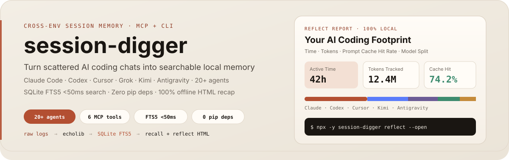
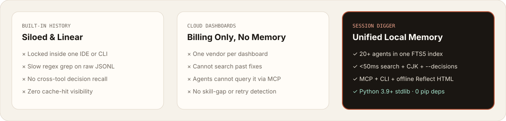
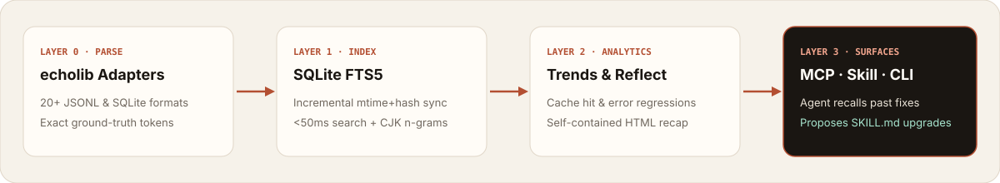

<p align="center">
  
</p>

<p align="center">
  <strong>English</strong> ·
  <a href="README.zh.md">简体中文</a>
</p>

<p align="center">
  <a href="#quick-start">Quick Start</a> ·
  <a href="#why-session-digger">Why Session Digger</a> ·
  <a href="#how-it-works">How It Works</a> ·
  <a href="#mcp-tools">MCP Tools</a> ·
  <a href="#supported-environments">20+ Environments</a> ·
  <a href="#cli-reference">CLI</a>
</p>

<p align="center">
  <a href="https://github.com/taxueseek/session-digger/stargazers"></a>
  <a href="https://github.com/taxueseek/session-digger/actions/workflows/ci.yml"></a>
  <a href="https://github.com/taxueseek/session-digger/releases"></a>
  <a href="LICENSE"></a>
  <a href="#supported-environments"></a>
  <a href="#mcp-tools"></a>
  <a href="#quick-start"></a>
</p>

> **Part of the AI Coding Agent Enhancement Suite**: [argo](https://github.com/taxueseek/argo) (web search &amp; verification) · **session-digger** (cross-agent memory &amp; usage stats) · [agent-relay](https://github.com/taxueseek/agent-relay) (cross-tool task handoff) · [code-gate](https://github.com/taxueseek/code-gate) (code review gate).

**Switched AI coding tools and lost your context?** **Session Digger** brings together your past conversations across **Claude Code, Codex, Cursor, Grok Build, Kimi Code, Antigravity, Trae, Cline, and 12+ other agents** into one unified local memory.

Search any past bug fix or design decision in under 50ms, track token usage and cache hit rates across tools, and generate a clean offline HTML recap — **zero pip dependencies, 100% local, never uploads your transcripts**.

---

## Quick Start

Pick your client — everything runs locally with zero external API keys:

- **Claude Code (MCP)**:
  ```bash
  claude mcp add session-digger -- npx -y session-digger
  ```
- **Agent Skill (`skills.sh` — Claude Code, Codex, Cursor, Antigravity)**:
  ```bash
  npx -y skills add taxueseek/session-digger -g --all
  ```
- **Cursor / Windsurf / Cline (`mcpServers` JSON)**:
  ```json
  {
    "mcpServers": {
      "session-digger": { "command": "npx", "args": ["-y", "session-digger"] }
    }
  }
  ```
- **Direct CLI (`npx` or `git clone`)**:
  ```bash
  # Build the incremental FTS5 index once (~5-30s)
  npx -y session-digger index

  # Search across all 20+ environments (<50ms)
  npx -y session-digger search "auth bug" --scope all --decisions

  # Open your self-contained local HTML usage report
  npx -y session-digger reflect --months 3 --open
  ```
- **Claude Code Plugin / Herdr / DSH**:
  ```bash
  git clone https://github.com/taxueseek/session-digger.git ~/.claude/plugins/session-digger
  # or: herdr plugin install taxueseek/session-digger
  # or: dsh plugin --profile web add "github:taxueseek/session-digger#main&path:dsh-plugin"
  ```

---

## Why Session Digger

<p align="center">
  
</p>

| Capability | Built-in IDE/CLI History | Vendor Billing Dashboards | Session Digger |
| :--- | :--- | :--- | :--- |
| **Cross-Agent Coverage** | Locked to one tool | Single vendor only | **20+ agents** in one unified schema (`~/.session-digger/index.db`) |
| **Search Speed &amp; CJK** | Linear file grep | No transcript search | **SQLite FTS5 (&lt;50ms)** with incremental mtime+hash sync &amp; CJK n-grams |
| **Decision Recall** | Full noisy chat dump | None | **`--decisions` mode** cuts recall tokens by 60–80% |
| **Cost &amp; Cache Visibility** | None | Aggregate spend only | **Per-model token + prompt-cache hit rate** (`main` vs `subagent` split) |
| **Agent Integration** | Manual copy-paste | Web browser only | **6 MCP tools + CLI + Slash Commands** (`/recall`, `/reflect`, `/usage`) |
| **Privacy &amp; Dependencies** | Varies | Cloud-hosted | **100% local, zero pip dependencies** (Python 3.9+ stdlib) |

---

## How It Works

<p align="center">
  
</p>

Session Digger separates raw parsing from analytics and judgment calls:

1. **Layer 0 · Parse (`scripts/echolib/`)**: Exact adapters normalize JSONL, SQLite, and tree-structured logs into a canonical schema without altering source files.
2. **Layer 1 · Index (`scripts/index-builder.py`)**: Incremental fingerprint (`mtime + size + 4KB head-hash`) keeps `~/.session-digger/index.db` fresh for sub-50ms FTS5 queries.
3. **Layer 2 · Analytics (`scripts/trend-engine.py`, `scripts/reflect-report.py`)**: Pure arithmetic computes week/month deltas, tool error-rate regressions, cache hit rates, and generates an offline HTML report (`~/.claude/.session-digger/reports/reflect-YYYY-MM-DD.html`) with 6 themes.
4. **Layer 3 · Surfaces (`scripts/mcp_server.py`, `scripts/skill-gap-finder.py`)**: Exposes structured JSON via MCP, surfaces recurring friction points into reviewable `SKILL.md` proposals, and cross-references git commits.

---

## MCP Tools

Start the stdio MCP server with `npx -y session-digger` (or test single-shot via `npx -y session-digger call <tool> '<json>'`):

| Tool | Purpose | Key Parameters |
| :--- | :--- | :--- |
| `sd_search` | Full-text search across past sessions | `keyword`, `scope` (`current` \| `all`), `agent`, `decisions`, `limit` |
| `sd_sessions` | List recent sessions with metadata | `scope`, `agent`, `limit`, `keyword` |
| `sd_stats` | Aggregate sessions, tokens, and environment counts | `agent` |
| `sd_index` | Build or incrementally update the FTS5 index | `rebuild`, `agent` |
| `sd_trend` | Period-over-period trends &amp; tool error regressions | `mode`, `unit` (`week` \| `month`), `lookback`, `group_by` |
| `sd_reflect` | Generate self-contained offline HTML usage report | `months` (`1` \| `3` \| `6` \| `12`), `lookback`, `open_browser` |

---

## Supported Environments

Session Digger auto-discovers session stores via environment-variable-aware probes (never hardcoded to one user directory):

| Agent / Environment | Storage Format | Agent / Environment | Storage Format |
| :--- | :--- | :--- | :--- |
| **Claude Code** | JSONL | **Antigravity (Google)** | `transcript.jsonl` + summaries SQLite |
| **Codex** | `response_item` + `event_msg` | **Cursor** | `agent-transcripts` JSONL + SQLite |
| **Grok Build** | `chat_history.jsonl` + `events.jsonl` | **Kimi Code / Kimix** | `wire.jsonl` / JSONL |
| **Cline / Roo Code** | Task JSON logs | **Qwen Code / Kigi CLI** | JSONL (`SchemaProbe` discovery) |
| **ZCode / ZCode v2** | SQLite + `transcript.jsonl` | **DSH (DeepSeek Harness)** | zstd event stream (v2 store) |
| **Trae (Global &amp; CN)** | LLM summary store | **WorkBuddy / DIM / Reasonix** | `parentId` tree / session dirs |
| **External Chats** | JSON / CSV / Markdown / WeChat (`dialog-adapter.py`) | **Unknown JSONL** | Auto-detected via `format-detector.py` |

See [README.zh.md](README.zh.md) for details on sub-skills (`wechat-digger`, `git-mining`, `memory-management`, `env-master`, `env-radar`) and full Chinese documentation.

---

## CLI Reference

```bash
# Build or incrementally update index
python3 scripts/index-builder.py build

# Fast recall (<50ms after indexing; --decisions cuts tokens 60-80%)
python3 scripts/sd-recall.py search "database migration" --scope all --decisions --json
python3 scripts/sd-recall.py stats --json

# Offline HTML usage recap (self-contained, 6 themes)
python3 scripts/reflect-report.py --months 3 --open

# Longitudinal trends & tool error regressions
python3 scripts/trend-engine.py period-over-period --unit week --lookback 8
python3 scripts/trend-engine.py regressions --unit week

# Prompt-cache hit audit & skill-gap proposals
python3 scripts/cache_audit.py
python3 scripts/skill-gap-finder.py --min-occurrences 3
```

---

## Privacy &amp; Security

- **100% Local**: Reads local logs and writes only to `~/.session-digger/index.db` (or `$SESSION_DIGGER_DATA_DIR`) and local HTML reports. Zero telemetry, zero network calls.
- **Read-Only on Transcripts**: Source agent logs are never modified.
- **No Decryption Stack**: The optional `wechat-digger` sub-skill only reads already-decrypted exports and includes no key extraction or decryption tooling.

---

## License

[ISC](LICENSE)

---

<p align="center">
  <sub>session-digger v0.9.38 · Local-First · Read-Only on Logs · Zero Pip Dependencies</sub>
</p>
